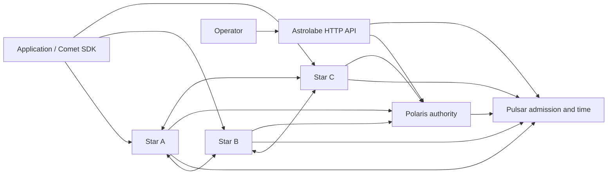

# Architecture and guarantees

[Documentation](README.md) · [Deployment](deployment.md) · [Protocols](../proto/README.md)

## Services and clients

The drawing shows logical relationships, not a required physical full mesh. A **Galaxy** is the deployment's infrastructure namespace. A **group**
expresses connection locality preference; it is not an authorization boundary. Each Star in the standard three-node topology accepts its own writes
and participates in cross-node replication and subscriptions.

Pulsar issues infrastructure credentials, maintains durable membership and provides a separate time endpoint for Stars. Polaris owns durable
configuration. Stars discover it through Pulsar and initiate synchronization streams. Astrolabe provides management login and proxies operations; it
does not own a second configuration database.

Comet connects to Star's application listener. It neither logs in to Pulsar nor becomes an infrastructure member. One Client selects an active Star
from configured endpoints rather than writing to all endpoints simultaneously.

## Data domains

A Scope is the pair `(sector, spectrum)`. Both are application-defined identifiers; keys and payload bytes live inside that Scope.

| Domain | Writer | Reader | Persistence and lifetime |
| --- | --- | --- | --- |
| Almanac | Astrolabe → Polaris | Comet Reader through Star | Durable authority; synchronized memory views on Stars |
| Catalog | Comet Publisher → Star | Comet Subscriber | Explicit atomic batches with finite TTL; no automatic Publisher renewal |
| Ephemeris | Comet Beacon → Star | Comet Observer | Registration with finite TTL, renewal and same-handle recovery |

Payloads are opaque bytes. A present empty value differs from an absent key. Applications own serialization and assign a single writer for each
Catalog key; Catalog has no cross-writer transaction coordinator.

## Commits and visibility

- A Polaris receipt confirms the authoritative transaction. Star synchronization follows asynchronously.
- A Catalog or Ephemeris receipt confirms the operation at the attached Star, not simultaneous visibility on every replica.
- A complete Scope snapshot or batch is installed before that subscription exposes it. Separate exact-key subscriptions do not form a joint atomic read.
- Timeout, cancellation or lost response can leave a write's result unknown. Transport failure does not prove that nothing committed.
- A listener opening, membership registration or management login does not prove data bootstrap is complete. Observe subscription readiness and actual operation results.

There is no global transaction across Scopes, no simultaneous replica-visibility guarantee, and no durable Catalog/Ephemeris storage after all
replicas lose their state.

## Time and recovery

Stars sample Pulsar and use continuous-time estimates for dynamic-data deadlines. Host clock synchronization remains an operator responsibility. SDKs
do not compare their wall clock with a remote absolute expiration timestamp.

Publisher updates carry a fresh TTL. Failed or uncertain payloads are not retained for later replay. After a Star switch, the next explicit update
determines new content.

A previously established Beacon may recover the same logical ID using its retained capability and last confirmed data. A new process cannot take over
a registration merely by knowing its UUID or API key. Old-source remnants expire; failover does not promise globally monotonic values or one instant
at which every replica changes source.

Readers retain their last complete view while tracking stale/recovering state. Applications must consider state as well as data; an unready
subscription is not a confirmed empty result.

## Trust and operational limits

Infrastructure TLS/admission, application TLS/API credentials and management cookies/accounts are separate trust boundaries. Keep their keys and
access policies separate. Disabling application authentication or TLS is an explicit choice, never an automatic fallback.

Polaris is a singleton authority with a fixed database/deployment binding. Pulsar has its own independently bound membership database. Automatic
authority failover, database rollback and cluster-wide backup restoration are not supplied by 0.1.0. See
[recovery](deployment.md#restart-and-recovery).

Resource quotas bound local admission, snapshots, readers and writers. A quota rejection is an explicit failure. Application-retained values and slow
callbacks still consume application resources; keep callbacks short and place application work on a bounded executor.
